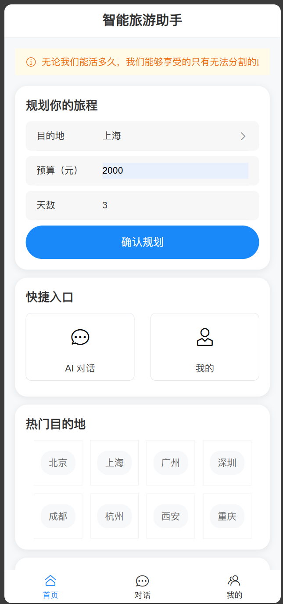
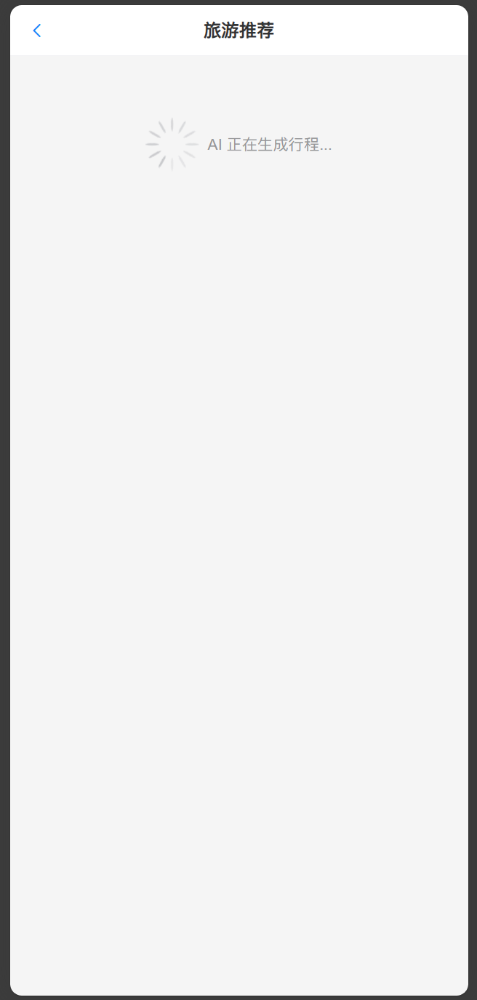
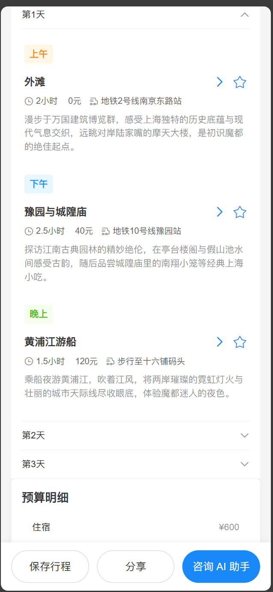
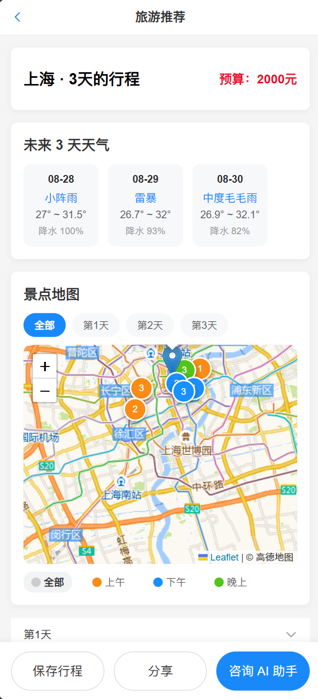
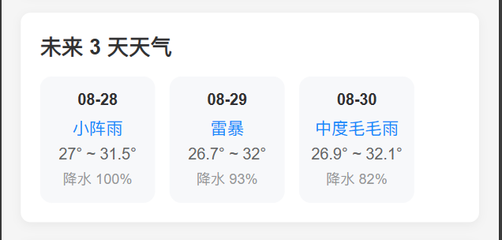
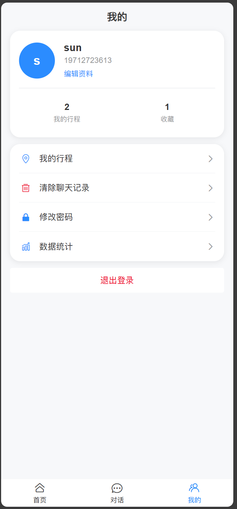

<div align="center">

# 🤖 AI Travel Planner

> 基于大语言模型的智能旅游规划助手 · Spring Boot + Vue 3 全栈项目

[](https://spring.io/)
[](https://vuejs.org/)
[](https://www.mysql.com/)
[](https://nodejs.org/)
[](LICENSE)

[功能特性](#-功能特性) · [项目截图](#-项目截图) · [技术栈](#-技术栈) · [快速开始](#-快速开始) · [项目结构](#-项目结构) · [接口文档](#-主要接口)

</div>

---

## ✨ 功能特性

| 功能 | 说明 |
|---|---|
| 🧠 **AI 智能规划** | 根据目的地、预算、天数，大模型生成详细行程（SSE 流式输出） |
| 🔐 **用户系统** | 注册 / 登录 / JWT 鉴权 / 个人资料管理 |
| 📋 **行程管理** | 保存行程 / 查看历史 / 一键编辑 |
| ⭐ **景点收藏** | 喜欢的景点随时收藏，快速回顾 |
| 🌤️ **实时天气** | 目的地 3 天天气预报，出行前心中有数 |
| 🗺️ **景点地图** | 高德地图标注景点，按天数/时段筛选，行程一目了然 |
| 🧭 **一键导航** | 点击景点直接跳转高德地图 APP/网页版导航 |
| 💬 **AI 对话** | 旅游相关问题智能问答 |
| 📸 **行程分享** | 生成行程图片，下载或分享给朋友 |

## 📸 项目截图

| 首页 | AI 行程规划 |
|---|---|
|  |  |

| 行程详情 | 景点地图 |
|---|---|
|  |  |

| 实时天气 | 个人中心 |
|---|---|
|  |  |

## 📦 技术栈

### 后端
- [Spring Boot 4.x](https://spring.io/projects/spring-boot) — Web 框架
- [Spring Data JPA](https://spring.io/projects/spring-data-jpa) — 数据访问
- [MySQL 8](https://www.mysql.com/) — 数据库
- [OkHttp](https://square.github.io/okhttp/) — HTTP 客户端（调用 LLM API）
- [JWT](https://jwt.io/) — 无状态鉴权
- [SSE](https://developer.mozilla.org/docs/Web/API/Server-sent_events) — 流式输出

### 前端
- [Vue 3](https://vuejs.org/) + Composition API — UI 框架
- [Vant 4](https://vant-ui.github.io/vant/) — 移动端 UI 组件库
- [Vite](https://vitejs.dev/) — 构建工具
- [Pinia](https://pinia.vuejs.org/) — 状态管理
- [Leaflet](https://leafletjs.com/) — 地图

### 第三方服务
| 服务 | 用途 | 是否免费 |
|---|---|---|
| [SiliconFlow](https://cloud.siliconflow.cn) | LLM 推理（GLM-5.1） | 有免费额度 |
| [Open-Meteo](https://open-meteo.com) | 天气数据 | 完全免费 |
| [高德开放平台](https://open.amap.com) | 地理编码 / 地图瓦片 / 导航 | 个人开发者免费 |

## 📁 项目结构

```
ai-travel-planner/
├── travel-project1/                  # 后端
│   ├── pom.xml
│   └── src/main/
│       ├── java/org/example/travel_project1/
│       │   ├── controller/           # REST API
│       │   │   ├── AuthController         # 登录注册
│       │   │   ├── TravelController       # AI 行程推荐（SSE）
│       │   │   ├── TravelPlanController   # 行程 CRUD
│       │   │   ├── FavoriteController     # 收藏
│       │   │   ├── WeatherController      # 天气
│       │   │   ├── GeoController          # 高德地理编码代理
│       │   │   ├── ChatMessageController  # AI 对话
│       │   │   └── UserController         # 用户信息
│       │   ├── service/              # 业务逻辑
│       │   ├── repository/           # 数据访问
│       │   ├── entity/               # JPA 实体
│       │   ├── dto/                  # 请求参数
│       │   ├── vo/                   # 返回值
│       │   ├── common/               # 配置 / 过滤器 / 异常处理
│       │   └── utils/                # LLM 调用工具
│       └── resources/
│           ├── application.example.yml   # 配置模板
│           └── ...
│   └── src/test/                     # 接口测试（H2 内存库，不依赖 MySQL）
├── travl-1/                          # 前端
│   ├── package.json
│   ├── vite.config.js
│   └── src/
│       ├── views/                    # 页面
│       ├── components/               # 组件（含空态/骨架屏）
│       ├── router/                   # 路由（全部懒加载）
│       ├── stores/                   # Pinia
│       └── utils/                    # 请求封装 + 登录态存储
├── docs/
│   ├── screenshots/                  # 项目截图
│   └── sql/travel_init.sql           # 建库建表脚本（5 张表，可重复执行）
├── start.cmd                         # 一键启动（双击）
└── start.ps1                         # 一键启动的实际逻辑
```

## 🚀 快速开始

### 最省事：双击 `start.cmd`

会自动检查 MySQL、拉起后端（3200）和前端（5174），等后端就绪后打开浏览器。已经运行的服务会自动跳过。

> 本机 PowerShell 执行策略禁止 `.ps1`，所以入口是 `.cmd`，它用 `-ExecutionPolicy Bypass` 调用 `start.ps1`。

### 手动启动：见下面 1~5 步

### 环境要求

| 工具 | 版本 |
|---|---|
| JDK | 17+ |
| Node.js | 18+ |
| MySQL | 8+ |
| Maven | 3.8+ |

### 1. 克隆项目

```bash
git clone https://github.com/Sunly9/ai-travel-planner.git
cd ai-travel-planner
```

### 2. 配置后端

```bash
cd travel-project1
cp src/main/resources/application.example.yml src/main/resources/application.yml
```

编辑 `application.yml`，填入你自己的密钥（生产环境建议改用环境变量注入）：

```yaml
llm:
  api-key: sk-你的SiliconFlow密钥

spring:
  datasource:
    password: 你的MySQL密码

jwt:
  secret: 自定义随机字符串（不少于 50 字符）

amap:
  key: 你的高德Web服务Key
```

#### 换一个模型供应商（都是云调用，都支持免费额度）

后端调用的是「OpenAI 兼容」协议，所以换供应商只需改三个值（推荐用环境变量）：

| 供应商 | `LLM_BASE_URL` | `LLM_MODEL` | 说明 |
|---|---|---|---|
| 硅基流动 SiliconFlow | `https://api.siliconflow.cn/v1` | `Pro/zai-org/GLM-5.1` | 默认，需账户有余额，否则返回 402 |
| 智谱 BigModel | `https://open.bigmodel.cn/api/paas/v4` | `glm-4-flash` | **免费模型**，注册即用 |
| 阿里云百炼 | `https://dashscope.aliyuncs.com/compatible-mode/v1` | `qwen-plus` | 新用户有免费 token 额度 |
| ModelScope 魔搭 | `https://api-inference.modelscope.cn/v1` | `Qwen/Qwen2.5-7B-Instruct` | 有免费推理额度 |

```powershell
$env:LLM_BASE_URL='https://open.bigmodel.cn/api/paas/v4'
$env:LLM_MODEL='glm-4-flash'
$env:LLM_API_KEY='你的智谱key'
# 然后启动后端即可，代码不用改
```

额度不足时后端会返回明确提示（`AI 服务额度不足：请更换有可用额度的 API Key…`），不会静默失败。

### 3. 数据库

```sql
CREATE DATABASE travel CHARACTER SET utf8mb4 COLLATE utf8mb4_0900_ai_ci;
```

也可以直接导入仓库里自带的脚本 [`docs/sql/travel_init.sql`](docs/sql/travel_init.sql)：包含建库 + 4 张表的完整 DDL（含索引、唯一约束和字段注释），可重复执行，不会清空已有数据。

JPA 配置 `ddl-auto: update`，启动时若发现缺表会自动补建（生产环境建议改为 `validate`，避免自动修改表结构）。

### 4. 启动后端

```bash
cd travel-project1
mvn spring-boot:run
# → http://localhost:3200
```

### 5. 启动前端

```bash
cd travl-1
npm install
npm run dev
# → http://localhost:5174
# 端口固定 5174（5173 常被本机其他项目占用，避免打开错应用）
```

### 6. 运行测试

```bash
cd travel-project1
mvn test
```

测试使用 H2 内存库（`src/test/resources/application-test.yml`），**不依赖本地 MySQL**。当前 7 个用例覆盖：公开接口可访问、未登录返回 401、注册→拿 token→访问行程、重复用户名返回 400、参数校验返回 400、保存行程并回读。

## 📡 主要接口

| 方法 | 路径 | 说明 | 需登录 |
|---|---|---|---|
| POST | `/api/auth/register` | 用户注册（返回 token） | ❌ |
| POST | `/api/auth/login` | 用户登录 | ❌ |
| POST | `/api/auth/refresh` | 刷新 token | ✅ |
| GET / PUT | `/api/user/profile` | 获取 / 更新个人资料 | ✅ |
| PUT | `/api/user/password` | 修改密码 | ✅ |
| GET | `/api/user/stats` | 统计（含最近 7 天趋势） | ✅ |
| POST | `/api/travel/recommend/stream` | AI 行程推荐（SSE 流式） | ❌ |
| POST | `/api/travel/recommend` | AI 行程推荐（同步） | ❌ |
| POST | `/api/travel/chat` | AI 对话（SSE 流式） | ❌ |
| GET | `/api/travel/hello` | 健康检查 | ❌ |
| POST / GET | `/api/plans` | 保存 / 列表 | ✅ |
| GET / PUT / DELETE | `/api/plans/{id}` | 详情 / 更新 / 删除 | ✅ |
| POST / GET / DELETE | `/api/favorites` | 收藏 / 列表 / 取消 | ✅ |
| GET | `/api/favorites/check?spotName=` | 是否已收藏 | ✅ |
| GET / POST / DELETE | `/api/chat-messages` | 对话历史 / 保存 / 清空 | ✅ |
| GET | `/api/weather?city=` | 天气（Open-Meteo，无需 key） | ❌ |
| GET | `/api/geo/search?address=&city=` | 地理编码（高德代理 + 落库缓存） | ❌ |

## 🔐 安全说明

- `application.yml` 不提交到 Git（已加入 `.gitignore`）
- 密钥通过环境变量或本地配置文件注入
- JWT token 有效期 24 小时，支持自动续期（记住我 → localStorage，否则 sessionStorage）
- 密码 BCrypt 加密存储
- 敏感接口需登录访问；业务异常返回真实 HTTP 状态码（400/401/500）

## ⚠️ 已知限制

| 项 | 说明 |
|---|---|
| AI 额度 | 调用 SiliconFlow，账户余额不足时返回 402，页面提示「AI 服务额度不足」；充值即恢复，或按上文切换其它免费模型 |
| 地图底图 | 直连高德瓦片地址，仅供个人学习研究，商用需申请官方授权/改用 JS API |
| 头像 | 以 base64 存 `MEDIUMTEXT`（前端压缩到 512px），量大会拖慢接口，后续建议改对象存储 |
| 行程数据 | `plan_data` 以 JSON 文本整存，不支持按景点/预算检索 |
| 规模 | 单机单实例设计，未做分布式限流/多租户 |

## 📝 License

MIT © [Sunly9](https://github.com/Sunly9)
